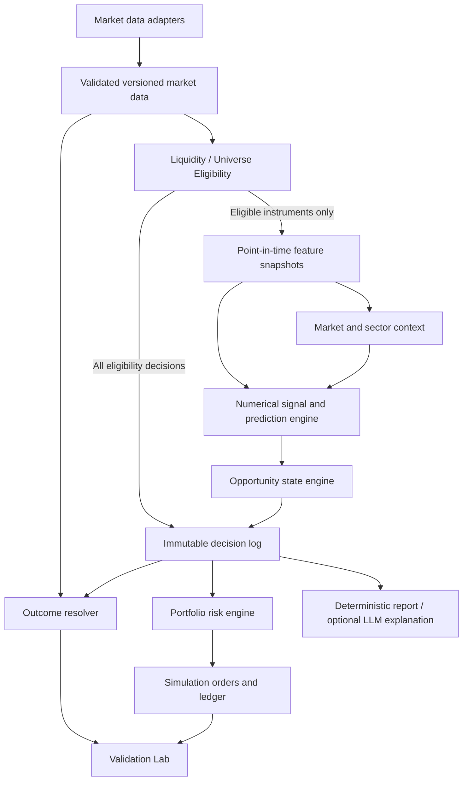

# InvestmentAI design specification

Date: 2026-10-04  
Status: Proposed design; implementation has not started.  
Scope: Local investment research, historical simulation, and forward paper trading.

## 1. Goals and boundaries

InvestmentAI evaluates opportunities under uncertainty. It does not claim to predict the future with certainty. Its eventual outputs are opportunity quality, return and downside distributions, risk/reward, evidence quality, likely horizon, and bullish/base/bearish scenarios.

Two distinct modes share infrastructure but have separate strategies, models, feature definitions, execution assumptions, and validation reports:

- **Swing:** days to weeks; implement and verify this first using daily bars.
- **Short-Term:** minutes to hours; deferred until the Swing pipeline passes its validation gates.

Numerical models and deterministic calculations own every price, return, probability, confidence value, score, and risk calculation. An optional language model explains supplied evidence only. It has no authority to create or modify numerical outputs or trading decisions.

### Version 0.1

- A versioned fixed candidate universe of 20–50 U.S. stocks for pipeline testing and validation, automatic liquidity eligibility checks, a broad-market benchmark, and sector metadata where available. Membership alone does not establish eligibility.
- Daily historical OHLCV ingestion, data quality checks, deterministic features, market regime assessment, opportunity states, and a CLI research report.
- Reproducible historical backtesting, immutable decision/prediction snapshots, a simulated long-only cash portfolio, and basic validation reporting.
- Initial fixed evaluation horizons of 5, 10, and 20 trading sessions, with 10 sessions as the primary horizon. These are proposed research settings, not verified optimal holding periods.
- Unsupported forecasts appear as unavailable. An operational rule-based prototype does not require a trained return model or a confidence number.

### Non-goals

No real-money execution, broker connections, brokerage credentials, live order-routing interfaces, leverage, short selling, options, autonomous financial advice, or guaranteed returns. News/event analysis, correlation-based sizing, intraday execution, advanced ML, LLM explanations, and a web dashboard are later capabilities.

This task creates this specification only. It does not create product code, configuration, databases, credentials, or dependency installations. All implementation actions below are future work.

## 2. Architectural decisions

### ADR-001: A modular Python application

**Status:** Proposed. **Decision owner:** Project owner. **Context:** Small daily universe, local research, auditability more important than throughput.

Use a single Python application with explicit module boundaries and typed, versioned contracts. Begin with batch jobs and a CLI; later expose application services through FastAPI and React + TypeScript. Prefer pure numerical functions and dependency injection at storage/provider boundaries.

Compared with microservices, this avoids deployment, queue, and distributed transaction complexity. Separate processes remain possible later because business logic does not depend on CLI or web handlers. No message broker or always-running service is needed in v0.1.

### ADR-002: SQLite initially, PostgreSQL when justified

Use SQLite for the local, single-user prototype, with foreign keys enabled, explicit transactions, schema migrations, a serialized writer, bounded busy retries, and consistent backups. SQLite supports one writer at a time, which is suitable for this batch workload; sustained concurrent writers or a multi-user service would justify PostgreSQL. See [SQLite deployment guidance](https://www.sqlite.org/whentouse.html).

The workspace is under OneDrive. The future active database, journals, and model artifacts should live in a configurable, non-synchronized local application-data directory, not the live OneDrive project directory. Export a consistent backup before copying it into synchronized storage. This is an operational design choice to avoid concurrent file synchronization and database writes.

| Option | Advantages | Costs / limits | Decision |
|---|---|---|---|
| SQLite | No server; transactions; simple local backup | One writer; local file lifecycle needs care | Initial store |
| PostgreSQL | Server access controls, concurrent writers, shared service | Service setup, credentials, operations | Migration target |
| Flat CSV/JSON only | Easy interchange | Weak relational integrity and transactional audit log | Import/export only |

Keep repositories behind domain interfaces; use portable relational types, explicit UTC timestamps, stable IDs, migrations, and validated JSON payloads. Avoid database-specific business logic. Migration must preserve IDs, hashes, foreign keys, counts, and financial totals; rehearse export/import and rollback before switching. SQLite protection is not tamper-proof against a machine administrator.

### ADR-003: Audit infrastructure before claims of performance

Define forecast labels, data availability semantics, immutable snapshots, and evaluation contracts before backtesting or ML. Backtest, forward paper trading, and validation must consume the same contracts. Start validation reporting before advanced models so every model is compared against an existing baseline.

### ADR-004: Separate research signal, portfolio permission, and explanation

An opportunity state describes a stock setup. A separate risk decision allows or rejects a simulated order for a particular portfolio. READY never means an order must be placed. The LLM is downstream of both and is optional; deterministic reports remain usable without it.

### ADR-005: Automatic liquidity eligibility

The system, not the user, determines whether an instrument is liquid enough for new setups. A Liquidity / Universe Eligibility module applies objective, versioned rules to market data before the Opportunity Engine. Neither a manually chosen candidate list nor a subjective user assessment can bypass this gate. Research configuration defines thresholds uniformly; it is not a per-stock user judgment.

Swing v0.1 evaluates the fixed 20–50-stock candidate universe using daily data. A wider Universe Scanner is a later scaling capability that reuses this gate; it is not required for v0.1.

## 3. Modules and data flow

| Module | Responsibility and boundary |
|---|---|
| Configuration / run registry | Immutable configuration snapshots, run IDs, seeds, versions, environment manifest |
| Instrument universe | Stable instrument IDs, symbol history, effective membership and sector classifications |
| Market data | Provider adapters, raw snapshots, normalization, calendars, corporate actions, quality flags |
| Liquidity / Universe Eligibility | Automatic trailing share/dollar volume and consistency checks; eligibility decisions and reason codes before opportunity analysis |
| Universe Scanner — later | Wider supported-instrument discovery, data-quality verification, and reuse of eligibility rules; only eligible candidates enter the Opportunity Engine |
| Features | Causal indicators with explicit lookbacks, availability times, and feature-set version |
| Regime / context | Benchmark trend and volatility; sector context when supplied |
| Signal / prediction | Rule components first; statistical/ML distributions later; no language model dependency |
| State engine | AVOID/WATCH/SETUP/READY plus machine-readable reason codes |
| Risk engine | Position limits, sizing, stop distance, concentration, rejection reasons |
| Prediction repository | Append-only input/output snapshots and provenance |
| Simulation | Shared event-clock execution model for backtest and forward paper runs |
| Outcome resolver | Separately append realized labels when horizons mature |
| Validation Lab | Metrics, cohorts, uncertainty, baselines, experiment comparison |
| Reporting | CLI first; API/UI and constrained LLM later |

Daily flow: ingest finalized session data → validate → seal a data snapshot → calculate liquidity and persist eligibility decisions for all candidates → send eligible stocks into feature and opportunity analysis → derive market/sector/stock signals → persist decision → apply portfolio risk checks → queue eligible simulated orders for the next session → record fills and portfolio events → resolve matured predictions → refresh metrics. Benchmark/context data and existing-position valuation continue independently of new-setup eligibility.

Runs use deterministic ordering by event time, event priority, then stable instrument/order ID. No future bar is accessible to a strategy at the current event time. Computation must be rerunnable offline from a pinned snapshot without calling a provider.

## 4. Time, universe, and market-data abstraction

### Time semantics

Store timestamps in UTC and exchange session dates separately. Use an exchange calendar in America/New_York for sessions, holidays, half-days, and daylight saving changes. A daily candle is usable only after its close and provider finalization delay. Store `event_time`, `available_at`, and `ingested_at`; these represent different facts.

Historical downloads generally do not prove when each revision was originally available. Mark such datasets `reconstructed_history`, document assumed availability, and do not call them fully point-in-time. Forward runs retain the actual first-seen timestamps. Later revisions never silently change a sealed experiment.

### Universe

Begin with a documented fixed candidate list of 20–50 stocks and record selection date, selection rule, exchange, currency, and membership intervals. Automatically reassess liquidity eligibility each session using only data available at that decision time; do not assume that a selected stock remains eligible. The user does not manually decide whether a stock is liquid enough. A list selected today creates survivor/selection bias when replayed historically; label initial tests accordingly. Broader claims require point-in-time membership and delisted instruments.

Use a stable instrument ID rather than a ticker as the primary identity. Preserve renames, splits, delistings, and sector changes. Treat missing sector data as unknown, never infer it through an LLM.

Select a benchmark explicitly: an investable S&P 500 proxy is a practical initial candidate; an index series is a different object and must be labeled as such. Freeze the exact instrument and total-return policy in each experiment.

### Liquidity / Universe Eligibility module

For Swing v0.1, use a proposed trailing window of 20 finalized daily sessions ending at the analysis cutoff. Calculate:

- **Average share volume:** mean daily share volume over the window, normalized to the current share basis for effective splits so comparisons and quantity caps use consistent units.
- **Average dollar volume:** mean of each session's raw close × raw share volume, in USD. Calculate the mean of daily products, not the product of mean price and mean volume. Daily close × volume is a daily-data turnover proxy, not measured execution capacity at the open.
- **Consistency:** median daily dollar volume, fraction of sessions meeting the configured daily liquidity floor, and largest session's share of total window dollar volume. Evaluate these alongside the averages so one unusually active day cannot establish eligibility.

Require complete, reliable observations for the window; do not silently skip missing sessions or fill missing volume with zero. Known zero-volume sessions remain observations that count against liquidity. Apply automatic minimum average dollar-volume and consistency rules; calculate average share volume regardless of whether a separate minimum share-volume gate is ultimately adopted. Exact floors, minimum passing-session fraction, and maximum single-session concentration remain research-policy decisions to freeze before evaluation. An unset required rule makes the policy invalid and blocks new setups rather than asking the user to judge individual stocks.

Return and persist instrument, mode, as-of time, source snapshot, rule version/thresholds, window coverage, calculated metrics, eligible flag, and all applicable machine-readable reason codes:

| Reason code | Meaning |
|---|---|
| `insufficient_liquidity` | Average dollar volume, or an enabled minimum share-volume rule, fails its threshold |
| `insufficient_history` | Too few reliable observations to evaluate the required window |
| `stale_data` | Latest required finalized session is unavailable beyond the freshness policy |
| `unstable_liquidity` | Recent-session consistency or concentration rules fail despite potentially adequate average volume |
| `unreliable_liquidity_data` | Invalid or inconsistent price/volume/action data prevents a trustworthy assessment |

Any failed required check makes the instrument ineligible for new SETUP/READY states and new simulated entries. Record exclusions even when no opportunity prediction is generated; diagnostic reports show AVOID with eligibility reasons. A high opportunity score or a volume spike cannot override the gate. Existing holdings still require valuation and exit management; becoming ineligible neither deletes a position nor assumes it can be liquidated immediately.

Future Short-Term eligibility adds bid/ask spread, intraday volume, spread stability, and depth/market-impact information when supported by the provider. Use mode-specific windows, thresholds, timestamp/freshness rules, and capability checks. Daily volume alone cannot establish Short-Term execution liquidity; unsupported quote/depth information must remain explicitly unavailable.

### Future Universe Scanner

After the small-universe pipeline is validated, add a scanner that starts from a wider set of supported instruments → verifies data quality → calculates liquidity → applies the same versioned eligibility rules → sends only eligible instruments into the Opportunity Engine. Persist candidate membership and exclusion reasons for reproducibility. This expands discovery coverage, not v0.1 scope, and does not replace the initial 20–50-stock validation universe.

### Provider contract

An adapter offers instrument metadata, OHLCV history by instrument/timeframe/range, corporate actions, provider capabilities, and health/quality information. Future intraday adapters add session coverage, interval duration, and finalization rules without changing numerical-engine interfaces.

Normalized bar fields: instrument ID, provider, timeframe, session, start/end UTC, available/ingested times, open/high/low/close, volume, currency, adjustment convention, source revision, raw-payload hash, and quality flags. Enforce uniqueness per instrument/provider/timeframe/bar start/revision.

Preserve raw prices and corporate actions. Use raw contemporaneous prices for fills. For technical features, derive a consistently split-adjusted window using only actions effective by the analysis date; adjust volume consistently. Do not mix raw highs/lows with adjusted closes. Credit dividends and adjust shares/stops in the paper ledger on the defined action dates. Total-return labels and benchmark comparisons must use the same dividend convention; provider adjustment semantics must be verified before use.

Reject impossible OHLC relationships, negative volume, duplicate conflicting bars, non-finite values, and missing currency. Quarantine suspicious jumps pending corporate-action checks. Missing sessions must be distinguished from exchange holidays, halts, and provider gaps; never fabricate tradable bars by forward-filling.

Provider selection remains open pending licensing, adjusted/raw availability, historical depth, revision behavior, rate limits, and cost. Failover requires explicit provenance and compatibility checks; it must not silently blend differently adjusted series.

## 5. Features and market regime

All windows end at the latest available finalized bar. Features are versioned with formulas, units, lookbacks, adjustment policy, null handling, and minimum history.

| Feature | Initial definition |
|---|---|
| EMA 20 / 50 | Close EMA with alpha = 2/(n+1), seeded by the first n-bar mean |
| RSI 14 | Wilder-smoothed gains/losses; no losses and positive gains → 100; both zero → 50 |
| ATR 14 | Wilder mean of max(high−low, abs(high−previous close), abs(low−previous close)) |
| Volume strength | Current volume / mean of preceding 20 sessions, excluding current session |
| Momentum | Close-to-close returns over 5, 10, and 20 sessions |
| Volatility | Sample standard deviation of 20 daily log returns; annualized with sqrt(252), assumption labeled |
| Trend | Close/EMA20−1, EMA20/EMA50−1, and EMA20 change over five sessions |
| Relative strength | Stock 20-session return minus aligned benchmark 20-session return |
| Liquidity | Trailing 20-session average share volume, mean of daily raw close × raw volume, and recent-session consistency metrics from the eligibility module |
| Later extensions | Sector-relative returns, event timing, news features with publication/availability timestamps |

Require 150 valid sessions as an initial EMA stabilization policy. A short or broken history makes the stock ineligible for a state requiring complete features. Zero denominators yield unavailable values and reason codes, not infinities. No missing return is replaced by zero.

Regime is two-dimensional: trend = bullish/bearish/sideways and volatility = normal/high/unknown. Bullish initially means benchmark close > EMA20 > EMA50 with positive five-session EMA20 slope; bearish is the reverse; otherwise sideways. High volatility initially means current 20-session realized volatility exceeds the 80th percentile of the preceding 252 realized-volatility observations, excluding the current observation. Insufficient history yields unknown. Thresholds are hypotheses, not established market laws.

Market → sector → stock is an explicit context chain. Initially, bearish, high-volatility, or unknown benchmark context prevents new long entries; stock signals can still be inspected. Sector metadata supports concentration checks; a missing sector-strength model contributes no fabricated signal. Later sector gates must be validated and versioned.

## 6. Opportunity score and state logic

The score is a transparent heuristic ranking from 0 to 100. It is not the probability of profit, a forecast return, or model confidence.

Proposed initial score, to freeze before evaluation:

| Component | Points |
|---|---|
| Trend | 10 each for close > EMA20, EMA20 > EMA50, and positive five-session EMA20 slope |
| Momentum | 10 each for positive 10-session return and RSI in [50, 70] |
| Relative strength | 20 if 20-session benchmark-relative return > 0; otherwise 0 |
| Volume strength | 15 if ratio ≥ 1.2; 7 if ratio ≥ 1.0; otherwise 0 |
| Market context | 15 bullish, 7 sideways, 0 bearish |

Do not renormalize missing components into an apparently complete score. Store component points and validity; critical missing features produce no score. Later alternative scores receive new strategy versions.

### State evaluation, in precedence order

1. **AVOID:** failed liquidity/universe eligibility (reported before opportunity scoring), invalid/stale data, inadequate history, market gate failure, ATR/close > 5%, or score < 40. These are strategy exclusions, not universal judgments about a company.
2. **WATCH:** eligible and score 40–64, or score ≥ 65 but setup conditions are absent.
3. **SETUP:** score ≥ 65, close > EMA20 > EMA50, RSI in [50, 70], and close no more than 2 ATR above EMA20; trigger not yet satisfied.
4. **READY:** setup conditions, score ≥ 80, close above the highest high of the preceding 20 sessions (excluding today), and volume strength ≥ 1.2. READY lasts only until the next eligible entry session; recompute each day.

Thresholds above are proposed testable defaults, not optimized claims. A state can move in either direction without passing through all intermediate states. Persist previous/current state and reasons. Missing benchmark data fails closed for new entries; unknown sector strength is disclosed but is not a v0.1 entry blocker.

A deterministic illustrative paper plan uses an entry reference at the signal close, a stop distance of 2 ATR, a target distance of 4 ATR, and a maximum 10-session holding period. These are strategy parameters, not expected outcomes. The actual plan is anchored to the simulated entry fill using the signal-time ATR. Store both reference and fill-derived levels separately.

Risk labels initially use ATR/close: Low ≤ 2%, Medium > 2% and ≤ 4%, High > 4%; > 5% blocks entry. These labels describe a limited volatility proxy and do not imply safety. Display concentration and missing event coverage separately.

## 7. Prediction architecture and numerical semantics

The output envelope includes instrument, mode, as-of/available time, horizon, target definition, source snapshot, model/strategy/feature versions, score/components, state/reasons, regime, risk metrics, optional forecasts, and explicit missing-field reasons.

Distinguish these fields:

- **Expected return:** model estimate of the conditional mean, if supported. A median is not a mean.
- **P10 / median / P90:** conditional quantiles of a specified forward total-return label; P10–P90 is a central 80% predicted interval, not a guaranteed range or confidence interval for the mean.
- **Expected downside:** only populate when a model predicts the defined maximum adverse excursion over a horizon; endpoint P10 must instead be labeled lower-tail terminal return.
- **Risk/reward:** planned target distance / stop distance, after labeled cost assumptions where appropriate. It is not an expected-value estimate or win probability.
- **Target-before-stop probability:** calibrated probability for a fully specified target/stop/horizon and label policy. Record timeout and ambiguous outcomes separately; do not condition on a hit without saying so.
- **Time horizon:** initially the selected fixed session count, not a learned time-to-target estimate. A time-to-event model is a separate later output.
- **Confidence:** initially unavailable. Later, any 0–100 evidence-quality score must have a documented formula based on held-out reliability, sample support, data quality, and distribution shift. It is not interchangeable with a calibrated outcome probability. Show underlying calibration metrics and sample counts.

Before validated models exist, numerical return/probability/confidence fields remain null with `not_supported` or `not_validated`; no placeholder example becomes a production prediction. Statistical baselines may emit empirical distributions only with training-window provenance and explicit baseline status.

Initial forecasting label: total return from the next eligible session's open through the close of the Hth holding session (entry session counts as 1), including dividends under the declared convention. This forecast exists independently of whether the portfolio can afford a trade. Trade P&L uses actual simulated fills, costs, and exits and must not be substituted for the forecast label.

Maximum adverse excursion uses the minimum raw-price path, adjusted consistently for actions, relative to the entry reference across that same horizon. Barrier labels use the strategy's signal-time ATR and fill/reference entry policy. Preserve label-definition versions.

Bull/base/bear scenarios may reference P90/median/P10 as distribution summaries once available; quantiles are not scenario occurrence probabilities. Qualitative conditions and invalidations can be deterministic rules without unsupported return forecasts.

### Model agreement

Reserve separate component outputs for trend, momentum, historical similarity, market, sector, and event risk. Each carries its own version, validity, direction, horizon, and evidence. Missing models appear as unavailable, not neutral votes. Initial trend/momentum/context signals are correlated and should not be represented as independent confirmations. Later ensembles learn weights on development data only, preserve component outputs, and disclose disagreement rather than averaging it away silently.

## 8. Database and artifact model

Use relational tables for identity, joins, immutable records, and the ledger. Use versioned validated JSON for flexible feature/prediction payloads. Small v0.1 histories fit in SQLite; large intraday datasets can later use partitioned columnar files with manifests while keeping the audit catalog relational.

| Entity | Principal fields / constraints |
|---|---|
| instruments / symbol_history | Stable ID, ticker intervals, venue, currency, status |
| universe_versions / members | Selection method/date, effective intervals, instrument IDs |
| sector_history | Instrument, classification, effective and known-at dates, source |
| bars / corporate_actions | Instrument, event and availability times, provider revision, action terms, hashes |
| data_snapshots | Manifest, retrieval time, dataset quality class, content hash |
| runs | Kind, mode, config hash, code version, snapshot ID, seed, start/end, status |
| eligibility_decisions | Instrument/mode/as-of, data snapshot, rule version/thresholds, window coverage, share/dollar volume and consistency metrics, eligible flag, reason codes; append-only, including excluded candidates |
| feature_snapshots | Instrument/as-of, feature-set version, snapshot ID, eligibility decision reference, payload/hash |
| model_versions | Artifact hash/path, training intervals, label definition, parameters, metrics, approval status |
| predictions | ID, run, instrument, mode, horizon, as-of, recorded-at, feature/model references, numerical payload, state/reasons, hash |
| outcome_observations | Prediction ID, label version, observed-at, maturity state, realized metrics, source snapshot, optional superseded observation ID |
| paper_accounts | Initial cash, base currency, risk policy version |
| risk_decisions / orders | Prediction ID, portfolio snapshot, allow/reject reasons, requested quantity, expiry, idempotency key |
| fills / ledger_events | Order ID, event/recorded times, quantity, price, fees, slippage assumptions, cash/share deltas |
| portfolio_snapshots | Account/time, ledger position, cash/equity, exposure, data staleness |
| metric_runs | Cohort definition, prediction/ledger IDs, metric version, results, maturity coverage |
| explanations | Prediction ID, structured input hash, prompt/model version, text, validation status |

Predictions and feature snapshots are append-only after commit. Repository APIs and database enforcement reject update/delete; corrections append a superseding record with a reason. Outcomes are separate append-only observations, so revisions never rewrite the original forecast. Mutable status projections are rebuildable from immutable events. Hashes detect accidental changes; strong adversarial tamper resistance would require separately protected audit storage.

Every simulated trade links an immutable prediction and records timestamp, instrument/symbol snapshot, fill price, model or rule version, forecast payload (including unavailable fields), expected return, downside, confidence, state, reasons/features, risk decision, execution assumptions, and run ID. Entry and exit fills are separately recorded.

Store monetary ledger values with an explicit fixed decimal scale and rounding policy, quantities as whole shares initially, and analytical feature values as floating-point with finite-value validation. Use transactions for fill + cash + position event creation. Unique idempotency keys prevent retries from duplicating decisions, orders, or fills. Index instrument/time, prediction horizon/maturity, run IDs, and account/event time.

## 9. Backtesting and simulation design

Use a chronological event replay sharing the state, risk, and execution modules with forward paper trading. Strategies can query only records available at the event clock. Data-loader access must enforce the time boundary rather than rely on strategy discipline.

### Execution assumptions

- Compute daily signals after finalized close; earliest fill is the next tradable session's open. Never fill at the same close used to generate the signal.
- Apply adverse slippage on both entry and exit and an explicit fee assumption. A provisional 10 basis points per side and zero commission may be used as a clearly labeled scenario; also report 0/10/25 basis-point sensitivities. Detailed spread/impact models are later work, but ignoring all costs until then is unacceptable.
- Set proposed limits to 0.5% equity at planned stop per entry, 10% per instrument, 30% per sector, 50% gross exposure, five simultaneous positions, no borrowing, and liquidity participation caps: shares ≤ 1% of trailing average daily share volume and order notional ≤ 1% of trailing average daily dollar volume. Use the eligibility module's latest valid snapshot available before execution; never use the execution session's future full-day volume for sizing. These proposed caps constrain paper fills, not guarantee opening liquidity. Unknown-sector positions share a conservative common bucket.
- Recheck automatic eligibility before new entries; reject an expired or failed eligibility assessment with its reason codes. Apply liquidity capacity constraints to simulated exits as well: excess quantity remains pending for later eligible execution events, and inability to fill must be reported rather than assuming unlimited stop/exit liquidity. Later Short-Term sizing must incorporate spread, intraday participation, and supported depth/impact information.
- Whole-share quantity is the floor of the minimum allowed by stop-risk budget, cash including costs, position/sector/gross caps, and liquidity cap. Zero quantity means rejection. Recheck at entry using available cash, entry price, and the frozen signal ATR.
- Stop and target become active after entry. A gap through a stop fills at the adverse open with slippage, not the stop price. A favorable gap through a target is conservatively filled at the target unless a separately validated execution policy says otherwise.
- If both stop and target are touched in a daily bar, assume stop first for simulated P&L and flag the ambiguity. Barrier-model labels remain ambiguous, rather than treating the pessimistic fill rule as known market truth; report bounds or use a prespecified exclusion with coverage disclosure.
- Exit at the close of the final planned holding session when neither barrier fires; that scheduled exit is determined in advance. No same-bar close signal can retroactively change it.
- Orders expire after the next eligible session. Missing execution bars never produce invented fills. Halted/delisted positions remain explicitly unresolved until a documented recovery/delisting policy can be applied.
- Rank simultaneous candidates by score, then stable instrument ID; define whether same-session exit proceeds are reusable. Initially use cash available at the open, avoiding optimistic reuse of later intraday proceeds.

Stop-risk sizing is a planning limit, not a guaranteed loss cap. Gaps may exceed it. Track actual drawdown and exposure continuously at the available daily resolution.

### Experimental design

Freeze chronological train/validation/test date boundaries before fitting (a provisional 60/20/20 allocation can guide selection, but actual dates must be written into the run). Align all stocks by session: no random row split across instruments or time. Purge training observations whose forward labels overlap validation/test periods; include a gap at least as long as the maximum relevant label horizon, with exact endpoint checks. Historical feature lookback before a boundary is permissible if it was already known at prediction time.

Use training data for model fitting and preprocessing; validation for a limited, logged selection process and calibration; untouched test data once for the frozen candidate. Expanding/rolling walk-forward evaluation follows once the basic split is trustworthy. Never refit using future outcomes merely because historical data is available now.

Compare with cash, benchmark buy-and-hold, equal-weight universe buy-and-hold, and a simple prespecified EMA rule, using consistent dates, capital, corporate actions, and cost conventions. Clearly label exposure differences and include an exposure-matched comparison when interpreting apparent outperformance.

## 10. Forward paper trading

Forward simulation uses information actually collected at each decision time and a separate account/run namespace from historical replay. It can ingest the next session's completed data later to resolve simulated fills, but must label execution as delayed daily simulation, not live market execution.

Persist decisions before subsequent outcome data is used. Recovery resumes from the committed event cursor; reconciliation rebuilds cash/positions from the ledger and rejects duplicate events. Existing positions continue to be tracked even if new-entry gates fail. Stale prices flag equity as stale; they do not prove a flat drawdown.

Proposed account starting cash is configurable (for example, USD 100,000 simulation capital) and is fixed per run. Do not mix historical trades with forward paper performance. Configuration changes start a new strategy version and a comparable account segment.

## 11. Validation Lab and release criteria

Separate prediction quality from trading performance, and separate backtest, validation, locked test, and forward-paper cohorts. Report denominators, unresolved labels, ambiguous cases, dates, fees, exposure, and sample sizes alongside every result.

| Metric | Definition / interpretation |
|---|---|
| Prediction count | Created, eligible, matured, unresolved, and evaluable counts separately |
| Win rate | Positive net-P&L closed trades / all closed trades; break-even trades reported separately |
| Average winner / loser | Mean positive / negative net closed-trade P&L; show currency and return basis |
| Expectancy | Mean net P&L per closed trade; include break-even trades in denominator |
| Profit factor | Sum of positive net trade P&L / absolute sum of negative net trade P&L; undefined if denominator is zero |
| Max drawdown | Maximum peak-to-trough decline in marked-to-market portfolio equity, including open positions and costs |
| Prediction error | MAE for point forecasts and pinball loss for quantiles; no error metric for unsupported forecasts |
| Calibration | Observed quantile coverage, interval width, reliability plots and Brier score for supported probability forecasts |
| Benchmark comparison | Total return, drawdown, turnover, exposure, same-period benchmark returns |
| Segmented performance | Regime at prediction time, stock, sector, horizon, model version, and mode |

P10/median/P90 calibration checks observed proportions below each quantile and coverage between P10–P90; interval width prevents uninformatively wide intervals looking excellent. Probability bins show counts and uncertainty. Short-Term comparisons remain unavailable until that mode exists.

Use time-block resampling and suitable dependence-aware intervals rather than treating overlapping stock/date outcomes as independent. Mark small cohorts exploratory; an initial display threshold of 30 matured observations is a usability rule, not proof of statistical sufficiency. Show losses, bad regimes, and failed experiments.

Engineering acceptance does not require profitability: reproducibility, correct chronology, complete reconciliation, and honest evaluation are mandatory. Model promotion additionally requires a preregistered baseline-relative objective, calibration tolerances, support requirements, and no material unexplained failures. Set those acceptance thresholds before inspecting the held-out test, not after finding favorable results.

For the initial operational paper gate, propose at least 60 trading sessions and 100 matured primary-horizon predictions with no unresolved ledger/data integrity defects. This is a minimum observation window, not proof of an edge. Lack of predictive value is a valid finding and may mean leaving ML outputs unavailable.

## 12. ML methodology and anti-overfitting controls

Begin with unconditional historical-return and simple rule baselines. Then evaluate limited scikit-learn candidates: regularized regression for conditional mean returns, quantile regression for quantiles, and calibrated classification for explicitly defined barrier outcomes. LightGBM/XGBoost are optional later candidates, not required dependencies.

Training examples are instrument/as-of/horizon records with feature and label provenance. Fit imputation, scaling, feature selection, and calibration only within the appropriate training/development folds. scikit-learn pipelines help prevent preprocessing leakage; see [official leakage guidance](https://scikit-learn.org/stable/common_pitfalls.html). A generic time splitter still needs panel-aware date grouping and label-overlap purging.

Use pooled models initially, with cautious categorical treatment and regularization; 20–50 instruments do not imply independent samples. Avoid separate per-stock models without enough history. Keep probability calibration data temporally later than fitting data and outside the locked test. Record any refit and its calibration policy explicitly.

Enforce ordered quantiles and bounded probabilities at validation. If a documented monotonic repair is used for crossing quantiles, version and evaluate that repair; never silently fix misleading outputs at presentation time. Out-of-distribution or low-support predictions abstain or show unavailable confidence.

Anti-overfitting controls:

- Register a small hypothesis set and parameter-search budget before evaluation; retain every attempted configuration and failed result.
- Freeze targets, universe, costs, metrics, and splits; treat edits as new experiments.
- Do not select features or tune thresholds on the locked test, entire-history correlations, or future sector membership.
- Report survivor bias, revised historical data, unavailable events, and ambiguous daily paths explicitly.
- Use ablations to test whether each feature/model adds value beyond simple baselines.
- Stress costs, gaps, date windows, regimes, and parameter neighborhoods; reject results dependent on a single stock or narrow setting.
- Treat repeated test inspection as contamination; require a new untouched interval for a fresh confirmatory result.
- Monitor distribution shift and calibration during forward paper operation; pause model promotion or new simulated entries on material integrity failures.

## 13. AI explanation layer and later presentation

The explanation service receives a sealed, read-only evidence envelope containing allowed facts, numerical field IDs, formatted values, units, missingness, provenance, scenario definitions, and reason codes. It cannot access a broker, portfolio write methods, model training, or arbitrary data retrieval.

Prefer structured narrative slots referring to existing evidence IDs. Render all financial numbers deterministically from those IDs after generation. Validate referenced facts, missing-value handling, directionality, certainty language, and contradictions; disallow unbound financial numbers. Invalid output is rejected and replaced with deterministic templates. Numeric checking alone is insufficient: qualitative claims must also map to supplied reasons.

Explain why a setup is interesting, why it may fail, required conditions, invalidation, bull/base/bear cases, and model disagreement. Never upgrade SETUP to READY through prose. Store input hash, prompt version, model identifier, and validation result. Future news is untrusted content and cannot supply instructions to the explanation service.

Later FastAPI endpoints expose read-only opportunities, prediction detail, portfolio projections, validation cohorts, and explanation results with explicit as-of time and versions. Any simulation-control endpoints are separate authenticated application commands with idempotency. React + TypeScript displays score, calibrated probability, and evidence quality with distinct labels; unavailable values remain visibly unavailable.

## 14. Error handling, security, and operations

| Failure | Behavior |
|---|---|
| Provider timeout/rate limit | Bounded exponential backoff with jitter; resume checkpoint; respect provider limits |
| Invalid/stale stock data | Quarantine and mark stock ineligible; include reason in run report |
| Missing benchmark | Block new entries; retain existing portfolio and flag valuation quality |
| Missing optional sector/news | Display unavailable; apply declared unknown-sector policy |
| Feature/model contract error | Reject affected output; no invented defaults or probabilities |
| Database lock/disk failure | Roll back transaction, bounded retry if safe, stop writes and surface actionable error |
| Crash during simulation | Replay from committed cursor using idempotency keys and reconcile ledger |
| LLM failure | Deterministic report remains available |
| Revised data | Append revision; original run remains pinned; create a separate corrected evaluation |

Use structured logs with run, instrument, prediction, and error IDs. Track ingestion freshness, rejection counts, pending outcomes, model abstentions, and reconciliation failures. A failed or partial run cannot appear as a completed successful analysis. Cached data must be versioned and freshness-checked.

Future provider/LLM keys come from environment variables or local `.env` files excluded from Git. Do not hard-code or log keys. Exclude active databases, private data, and model artifacts from source control; sanitized example configuration may list variable names only. Redact secret-bearing headers and error responses. Load only trusted model artifacts, since some serialization formats can execute code.

Bind any initial API to localhost; require authentication and transport protection before remote access. Keep permissions minimal. No broker SDK, broker credentials, or real-execution adapter belongs in this scope. Adding real money would require a separate design and explicit authorization, regardless of historical performance.

Back up sealed data manifests, SQLite snapshots, configuration, and model artifacts; periodically verify restoration and checksums. Define retention around provider licensing and reproducibility needs. Initial operational target: a cached daily run for 50 stocks completes within one minute on the chosen development machine; benchmark this later rather than assuming it, and measure provider latency separately.

## 15. Testing strategy

Future tests should target financial and temporal correctness rather than mirror implementation details:

- Hand-calculated indicator fixtures including flat prices, zero losses, split adjustments, insufficient history, and zero denominators.
- Provider contract tests for calendars, timestamps, duplicate revisions, missing sessions, and malformed OHLCV.
- Eligibility fixtures for low average volume, one-day spikes, inconsistent recent liquidity, stale/missing data, split-consistent share units, threshold boundaries, and exact reason codes; verify that fixed-universe membership and high scores cannot bypass the gate. Test share/notional participation caps and pending exit quantities without future-volume leakage.
- Causality tests: adding or changing future bars cannot alter past features, decisions, or training folds; overlapping labels are purged across all stocks.
- Golden event-replay cases for next-open entry, gap stops, simultaneous target/stop touches, dividends/splits, expiring orders, and scheduled exits.
- Ledger invariants: cash plus marked positions equals equity; no duplicate fills, negative unauthorized cash, or unexplained share changes; reconstruct projections after a crash.
- Persistence tests that reject prediction mutation and preserve original records through corrections, backups, and migrations.
- Metric fixtures covering no trades, no losses, break-even outcomes, open-position drawdown, missing valuations, and sparse calibration bins.
- Reproducibility test: pinned data/config/code/model versions produce matching numerical outputs within declared tolerance.
- Explanation tests with unsupported values, absent confidence, contradicting prose, and malicious text; invalid responses fall back safely.
- End-to-end offline fixture from data ingestion through decision, paper fill, outcome, and validation report before accepting provider-backed runs.

## 16. Phased implementation roadmap

The main improvement to the requested sequence is bringing immutable logging contracts and basic validation forward. A backtest without a frozen decision record is difficult to audit; ML without baseline metrics is difficult to assess. Full paper portfolios still follow the replay engine.

| Phase | Deliverables | Exit gate |
|---|---|---|
| 0 — Design | This specification; resolve initial provider, benchmark, adjustment, and target policies | Scope and technical assumptions reviewed; no implementation in this task |
| 1 — Data and CLI | Provider abstraction, canonical schema, calendars, snapshots, daily liquidity/eligibility module for the fixed 20–50 candidates, indicators, CLI diagnostics | Offline reproducibility and data/feature/eligibility fixtures pass |
| 2 — States and audit | Regime, component score, opportunity states, immutable decision records, basic risk contracts | Boundary, causality, and immutability checks pass; no invented forecasts |
| 3 — Replay and basic validation | Shared simulator, chronological splits, labels, costs, baselines, basic metric report | Known-path execution/ledger fixtures pass; bias limitations disclosed |
| 4 — Forward paper portfolio | Durable orders/fills/events, scheduling, recovery, outcome resolution | Reconciliation and crash recovery pass; forward and replay ledgers separated |
| 5 — Validation Lab | Cohorts, uncertainty, calibration-ready reports, walk-forward experiments | Metrics reconcile to raw evidence; frozen test protocol and paper observation gate met |
| 6 — ML forecasts | Baselines, limited candidate models, quantiles/probabilities, calibration, registry | Prespecified out-of-sample and forward evaluation; abstain if no supported improvement |
| 7 — AI explanations | Evidence-only structured explanations and deterministic fallback | Numerical grounding and contradiction tests pass |
| 8 — Dashboard | FastAPI and React + TypeScript over existing services | Same numerical outputs as CLI; missingness/provenance visible; access controls verified |
| 9 — Short-Term | Intraday adapters, new features/models, spread/latency simulation, separate validation | Swing pipeline verified; intraday data quality and execution fidelity separately demonstrated |
| Later scaling — Universe Scanner | Wider supported-instrument discovery → data-quality verification → liquidity calculation → eligibility filtering → Opportunity Engine | Small-universe pipeline validated first; exclusions and eligible membership reproducible; excluded instruments cannot reach opportunity analysis |

The Universe Scanner is outside v0.1 and can be scheduled independently after small-universe validation; it does not require Short-Term mode. Phase 9 extends the existing eligibility module with bid/ask spread, intraday volume, spread stability, and provider-supported depth/impact data rather than reusing daily thresholds unchanged.

Phases 7 and 8 may be reordered after numerical contracts stabilize: a deterministic dashboard need not wait for an LLM. Short-Term must not reuse Swing parameters or claim comparable performance without its own costs, horizons, microstructure assumptions, and forward testing. It remains paper-only.

## 17. Open technical questions

These decisions should be resolved before the relevant implementation phase; they do not block writing this design.

1. Which provider supports acceptable raw prices, actions, licensing, historical depth, and later intraday access within budget?
2. Which 20–50 instruments form the initial fixed candidate universe, and is point-in-time/delisted coverage available? Liquidity eligibility within it is automatic.
3. Which benchmark instrument and dividend convention will be frozen for the first experiment?
4. Is the proposed 10-session primary horizon suitable, and which historical periods give adequate train/validation/test coverage without outcome-driven selection?
5. What exact provider finalization delay and scheduler cutoff define a usable daily bar?
6. Should known earnings dates block new entries once reliable point-in-time event data is available? Until then, event risk is unmodeled and disclosed.
7. Are the proposed risk limits and cost stress assumptions acceptable for the simulated account? They require validation, not silent optimization.
8. What handling of delistings, halts, ambiguous barrier labels, and unavailable valuations is supportable by the chosen data source?
9. What prespecified prediction/calibration thresholds and sample support justify model promotion, and what drift thresholds cause abstention?
10. What local non-synchronized data location, backup retention, and eventual multi-user needs govern database migration?
11. What exact minimum trailing average dollar-volume threshold should the automatic eligibility policy use?
12. Should minimum average share volume also be required, in addition to calculating it for diagnostics and sizing?
13. How should liquidity thresholds, lookback windows, and consistency rules differ between Swing and Short-Term?
14. Which data provider can supply reliable bid/ask spread data for the later Short-Term engine, including the timestamps/history needed to assess spread stability?
15. What minimum fraction of sufficiently liquid sessions and maximum single-session volume concentration should define stable liquidity?

## 18. Completion boundary for this design task

The sole deliverable is `docs/specs/2026-10-04-investment-ai-design.md`. No dependencies, product implementation, provider connections, broker connections, or real-money trading are authorized by completion of this document. The next step is review of the design and a separately requested implementation phase.
